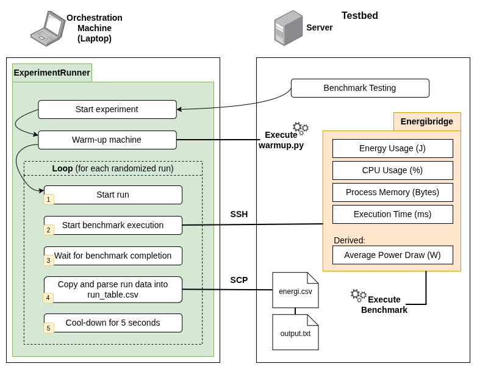

## The Sun Enjoyers - Green Lab 2026
Replication package for **Empirical assessment of guidelines to write energy-efficient Python code**, Vrije Universiteit Amsterdam.

## Overview

We investigate how applying eight Python energy-efficiency guidelines affects energy consumption and resource usage. The experiment contains **16 LeetCode problems** (eight Easy and eight Medium), **three implementation variants** per problem, and **two treatments** per variant (`original` and `modified`): 48 matched implementation pairs, or 96 code implementations. The design specifies **100 repetitions per implementation**, for **9,600 planned measurement runs**.

Measurements include CPU package energy, DRAM energy, benchmark runtime, measurement duration, average power, process CPU utilization, and process resident-set memory (RSS). Raw EnergiBridge CSV files also include per-core CPU utilization and frequency.

## Repository layout

| Path | Purpose |
| --- | --- |
| `problems/p*_*/baseline.py` | Original Python implementations (three variants per problem). |
| `problems/p*_*/guideline.py` | Guideline-modified implementations. |
| `tests/test_*.py` | Correctness tests for the 16 problems. |
| `metadata.json` | Problem and guideline metadata. |
| `experiment/workload_generator.py` | Deterministic input-workload generation. |
| `experiment/workloads/` | Frozen, repetition-specific workloads (`p<problem>_v<variant>_r<repetition>.json`). |
| `experiment/workloads.sha256` | Checksums for the frozen workload files. |
| `experiment/validate_workload.py`, `experiment/validate_final_workloads.py` | Workload correctness and consistency checks. |
| `experiment/check_readiness.py` | Pre-experiment readiness checks. |
| `experiment/calibrate_gl3.py`, `experiment/calibration_gl3.csv` | Per-problem/variant iteration calibration and recorded iteration counts. |
| `experiment/PairedRunTableModel.py` | Reproducible paired run schedule. |
| `experiment/RunnerConfig.py` | Experiment Runner hooks and remote testbed configuration. |
| `experiment/benchmark.py` | Validates and executes a treatment on a frozen workload. |
| `experiment/measure.py` | Invokes EnergiBridge and collects process-level CPU/RSS metrics. |
| `experiment/launch_experiment.py` | Launches Experiment Runner with deadline and stall safeguards. |
| `experiment/shared-results/YYYY-MM-DD/` | Dated checkpoints (`run_table.csv`, `metadata.json`). |

## External tools and environment

- [EnergiBridge](https://github.com/tdurieux/EnergiBridge) — Energy measurement tool. Experiment installation used **v0.0.7**. 
- [Experiment Runner](https://github.com/S2-group/experiment-runner) — Experiment orchestration. 
- **Python:** testbed used Python **3.13.12**. `psutil` is required by `experiment/measure.py`; `pytest` is useful for the repository's test suite. Install project-specific and Experiment Runner dependencies in dedicated virtual environments.
- **Testbed** VU Green Lab `gl3`, Linux (Ubuntu 24.04.4 LTS), 2 × Intel Xeon Silver 4208 CPUs (16 physical cores). Re-running measurements elsewhere may produce different energy and performance results. An SSH-accessible host with an installed `energibridge` executable is needed for the remote experiment.
- **Orchestration machine:** a separate Linux machine running Experiment Runner and connecting to the testbed by SSH.


## Experiment Architecture

The following diagram illustrates the interaction between the orchestration machine and the measurement testbed.



## Measurements and dataset schema

The experiment's run table contains:

| Column | Meaning |
| --- | --- |
| `__run_id` | Run identifier, including experimental configuration and repetition. |
| `__done` | Experiment Runner status (`DONE` or `TODO`). |
| `problem`, `variant`, `treatment` | Experiment factors. |
| `package_energy_j`, `dram_energy_j` | CPU package and DRAM energy (joules). |
| `benchmark_runtime_seconds` | Timing reported for the benchmark execution. |
| `measurement_duration_seconds` | Duration of the measurement interval. |
| `average_power_w` | Derived average power (watts). |
| `avg_cpu_usage_percent` | Process-level CPU utilization derived using `psutil`. |
| `avg_rss_bytes`, `peak_rss_bytes`, `rss_samples` | Process RSS summaries and number of memory samples. |
| `workload_seed`, `workload_sha256` | Input-workload provenance. |

## Final  experimental dataset
- **Completed:** 9589 measurements
- **Incomplete:** 11 measurements
- **Final run table:** [run_table.csv](experiment/shared-results/2026-10-23/run_table.csv)
- **Raw measurements:** [Download the GitHub Release archive](https://github.com/kaczynskimat/greenlab/releases/tag/greenlab-data-2026-10-23)


## Running or resuming the experiment
```bash
cd /path/to/greenlab
export REPO="$PWD"
export RUNNER_ROOT="/path/to/experiment-runner"
export PYTHONPATH="$REPO:$REPO/experiment:$RUNNER_ROOT/experiment-runner"

"$RUNNER_ROOT/.venv/bin/python" experiment/launch_experiment.py \
  --runner-root "$RUNNER_ROOT" \
  --repo "$REPO" \
  --deadline "YYYY-MM-DDTHH:MM:SS+02:00" \
  --safety-minutes 5 \
  --stall-seconds 1800
```

Replace `$RUNNER_ROOT`, `$REPO`, Python paths, deadlines, and SSH settings for another environment. 

### LeetCode Problems:
16 Problems - 8 Easy - 8 Medium

| Guideline ID | Family             | Difficulty | LeetCode # | Problem Name                                    | LeetCode URL |
|--------------|--------------------|------------|------------|-------------------------------------------------|--------------|
| G1           | Code Optimization	 | Easy	      | #387	      | First Unique Character in a String I                      | 	https://leetcode.com/problems/first-unique-character-in-a-string/        |
| G1           | 	Code Optimization | 	Medium    | 	#3        | 	Longest Substring Without Repeating Characters | 	https://leetcode.com/problems/longest-substring-without-repeating-characters/        |
| G2	          | Code Optimization  | 	Easy	     | #977	      | Squares of a Sorted Array	                      | https://leetcode.com/problems/squares-of-a-sorted-array/         |
| G2	          | Code Optimization	 | Medium	    | #240        | 	Search a 2D Matrix II	                               | https://leetcode.com/problems/search-a-2d-matrix-ii/        |
| G3	          | Code Optimization	 | Easy	      | #605       | 	Can Place Flowers	                            | https://leetcode.com/problems/can-place-flowers/         |
| G3	          | Code Optimization  | 	Medium	   | #15	       | 3Sum	                                           | https://leetcode.com/problems/3sum/         |
| G6	          | Code Optimization	 | Easy	      | #383	       | Ransom Note	                                    | https://leetcode.com/problems/ransom-note/         |
| G6	          | Code Optimization  | 	Medium	   | #442       | 	Find All Duplicates in an Array                | 	https://leetcode.com/problems/find-all-duplicates-in-an-array/        |
| G18	         | Function Calls	    | Easy	      | #509	      | Fibonacci Number	                       | https://leetcode.com/problems/fibonacci-number/         |
| G18	         | Function Calls     | 	Medium	   | #322	      | Coin Change	                                    | https://leetcode.com/problems/coin-change/         |
| G19	         | Function Calls     | 	Easy	     | #125	      | Valid Palindrome	                               | https://leetcode.com/problems/valid-palindrome/         |
| G19	         | Function Calls	    | Medium	    | #200	      | Number of Islands                               | 	https://leetcode.com/problems/number-of-islands/        |
| G24	         | Other	             | Easy	      | #867	      | Transpose Matrix	                               | https://leetcode.com/problems/transpose-matrix/         |
| G24	         | Other	             | Medium	    | #238	      | Product of Array Except Self	                   | https://leetcode.com/problems/product-of-array-except-self/         |
| G27	         | Other	             | Easy	      | #905	      | Sort Array By Parity                            | 	https://leetcode.com/problems/sort-array-by-parity/        |
| G27	         | Other              | 	Medium	   | #49	       | Group Anagrams                                  | https://leetcode.com/problems/group-anagrams/         |

### Documentation:
See the project report (PDF) for the experimental design, procedure, and analysis.

# Still TODO keep one version and adapt it?:

| Guideline ID | LeetCode # & Name (Difficulty) | Solution Variant | Smell Added By Us? | Description of Modification / Refactoring (Baseline vs. Refactored) |
| :--- | :--- | :--- | :--- | :--- |
| **G1** | #387 (First Unique Character in a String) <br> *(Easy)* | Solution 1 | **No** (Retrieved from LC) | **Baseline:**  <br>**Refactored:**  |
| **G1** | #387 (First Unique Character in a String) <br> *(Easy)* | Solution 2 | **No** (Retrieved from LC) | **Baseline:**  <br>**Refactored:**  |
| **G1** | #387 (First Unique Character in a String) <br> *(Easy)* | Solution 3 | **No** (Retrieved from LC) | **Baseline:**  <br>**Refactored:** |
| **G1** | #3 (Longest Substring Without Repeating Characters) <br> *(Medium)* | Solution 1 | **No** (Retrieved from LC) | **Baseline:** <br>**Refactored:** |
| **G1** | #3 (Longest Substring Without Repeating Characters) <br> *(Medium)* | Solution 2 | **No** (Retrieved from LC) | **Baseline:** <br>**Refactored:** |
| **G1** | #3 (Longest Substring Without Repeating Characters) <br> *(Medium)* | Solution 3 | **No** (Retrieved from LC) | **Baseline:** <br>**Refactored:** |
| **G2** | #977 (Squares of a Sorted Array) <br> *(Easy)* | Solution 1 | **Yes** (Injected) | **Baseline:** <br>**Refactored:** |
| **G2** | #977 (Squares of a Sorted Array) <br> *(Easy)* | Solution 2 | **Yes** (Injected) | **Baseline:** <br>**Refactored:** |
| **G2** | #977 (Squares of a Sorted Array) <br> *(Easy)* | Solution 3 | **Yes** (Injected) | **Baseline:** <br>**Refactored:** |
| **G2** | #240 (Search a 2D Matrix II) <br> *(Medium)* | Solution 1 | **Yes** (Injected) | **Baseline:** <br>**Refactored:** |
| **G2** | #240 (Search a 2D Matrix II) <br> *(Medium)* | Solution 2 | **Yes** (Injected) | **Baseline:** <br>**Refactored:** |
| **G2** | #240 (Search a 2D Matrix II) <br> *(Medium)* | Solution 3 | **Yes** (Injected) | **Baseline:** <br>**Refactored:**  |
| **G3** | #217 (Contains Duplicate) <br> *(Easy)* | Solution 1 | | |
| **G3** | #217 (Contains Duplicate) <br> *(Easy)* | Solution 2 | | |
| **G3** | #217 (Contains Duplicate) <br> *(Easy)* | Solution 3 | | |
| **G3** | #15 (3Sum) <br> *(Medium)* | Solution 1 | | |
| **G3** | #15 (3Sum) <br> *(Medium)* | Solution 2 | | |
| **G3** | #15 (3Sum) <br> *(Medium)* | Solution 3 | | |
| **G6** | #26 (Remove Duplicates from Sorted Array) <br> *(Easy)* | Solution 1 | | |
| **G6** | #26 (Remove Duplicates from Sorted Array) <br> *(Easy)* | Solution 2 | | |
| **G6** | #26 (Remove Duplicates from Sorted Array) <br> *(Easy)* | Solution 3 | | |
| **G6** | #442 (Find All Duplicates in an Array) <br> *(Medium)* | Solution 1 | | |
| **G6** | #442 (Find All Duplicates in an Array) <br> *(Medium)* | Solution 2 | | |
| **G6** | #442 (Find All Duplicates in an Array) <br> *(Medium)* | Solution 3 | | |
| **G18** | #746 (Min Cost Climbing Stairs) <br> *(Easy)* | Solution 1 | | |
| **G18** | #746 (Min Cost Climbing Stairs) <br> *(Easy)* | Solution 2 | | |
| **G18** | #746 (Min Cost Climbing Stairs) <br> *(Easy)* | Solution 3 | | |
| **G18** | #322 (Coin Change) <br> *(Medium)* | Solution 1 | | |
| **G18** | #322 (Coin Change) <br> *(Medium)* | Solution 2 | | |
| **G18** | #322 (Coin Change) <br> *(Medium)* | Solution 3 | | |
| **G19** | #125 (Valid Palindrome) <br> *(Easy)* | Solution 1 | | |
| **G19** | #125 (Valid Palindrome) <br> *(Easy)* | Solution 2 | | |
| **G19** | #125 (Valid Palindrome) <br> *(Easy)* | Solution 3 | | |
| **G19** | #200 (Number of Islands) <br> *(Medium)* | Solution 1 | | |
| **G19** | #200 (Number of Islands) <br> *(Medium)* | Solution 2 | | |
| **G19** | #200 (Number of Islands) <br> *(Medium)* | Solution 3 | | |
| **G24** | #867 (Transpose Matrix) <br> *(Easy)* | Solution 1 | | |
| **G24** | #867 (Transpose Matrix) <br> *(Easy)* | Solution 2 | | |
| **G24** | #867 (Transpose Matrix) <br> *(Easy)* | Solution 3 | | |
| **G24** | #238 (Product of Array Except Self) <br> *(Medium)* | Solution 1 | | |
| **G24** | #238 (Product of Array Except Self) <br> *(Medium)* | Solution 2 | | |
| **G24** | #238 (Product of Array Except Self) <br> *(Medium)* | Solution 3 | | |
| **G28** | #905 (Sort Array By Parity) <br> *(Easy)* | Solution 1 | | |
| **G28** | #905 (Sort Array By Parity) <br> *(Easy)* | Solution 2 | | |
| **G28** | #905 (Sort Array By Parity) <br> *(Easy)* | Solution 3 | | |
| **G28** | #49 (Group Anagrams) <br> *(Medium)* | Solution 1 | | |
| **G28** | #49 (Group Anagrams) <br> *(Medium)* | Solution 2 | | |
| **G28** | #49 (Group Anagrams) <br> *(Medium)* | Solution 3 | | |


| Guideline ID | LeetCode # & Name (Difficulty) | Solution Variant | Smell Added By Us? | Description of Modification / Refactoring (Baseline vs. Refactored) | Link to LeetCode|
| :--- | :--- | :--- | :--- | :--- | :--- |
| **G6** | #442 (Find All Duplicates in an Array) <br> *(Medium)* | Solution 1 | **No** (Retrieved from LC) | **Baseline:**  <br>**Refactored:**  | https://leetcode.com/problems/find-all-duplicates-in-an-array/description/ |
| **G6** | #442 (Find All Duplicates in an Array) <br> *(Medium)* | Solution 2 | **No** (Retrieved from LC) | **Baseline:**  <br>**Refactored:**  | https://leetcode.com/problems/find-all-duplicates-in-an-array/description/ |
| **G6** | #442 (Find All Duplicates in an Array) <br> *(Medium)* | Solution 3 | **No** (Retrieved from LC) | **Baseline:** <br>**Refactored:** | https://leetcode.com/problems/find-all-duplicates-in-an-array/description/ |
| **G18** | #509 (Fibonacci Number) <br> *(Easy)* | Solution 1 | **No** (Retrieved from LC) | **Baseline:** <br>**Refactored:** | https://leetcode.com/problems/fibonacci-number/description/ |
| **G18** | #509 (Fibonacci Number) <br> *(Easy)* | Solution 2 | **No** (Retrieved from LC) | **Baseline:** <br>**Refactored:**  | https://leetcode.com/problems/fibonacci-number/description/ |
| **G18** | #509 (Fibonacci Number) <br> *(Easy)* | Solution 3 | **No** (Retrieved from LC) | **Baseline:** <br>**Refactored:** | https://leetcode.com/problems/fibonacci-number/description/ |
| **G18** | #322 (Coin Change) <br> *(Medium)* | Solution 1 | **No** (Retrieved from LC) | **Baseline:** <br>**Refactored:** | https://leetcode.com/problems/coin-change/description/ |
| **G18** | #322 (Coin Change) <br> *(Medium)* | Solution 2 | **Yes** (Code Smell Injected) | **Baseline:** <br>**Refactored:** | https://leetcode.com/problems/coin-change/description/ |
| **G18** | #322 (Coin Change) <br> *(Medium)* | Solution 3 | **Yes** (Code Smell Injected) | **Baseline:** <br>**Refactored:** | https://leetcode.com/problems/coin-change/description/ |
